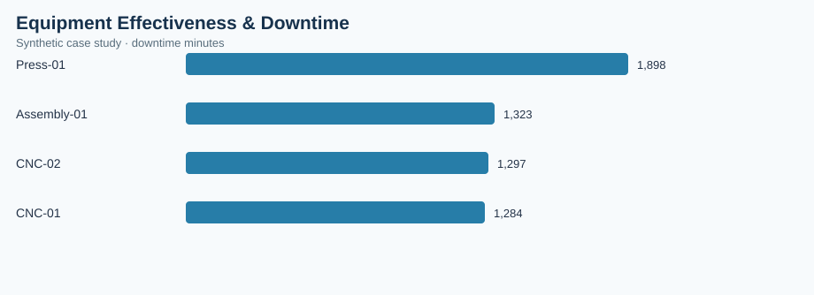

# Equipment Effectiveness & Downtime

> **Illustrative case study — synthetic data.** All observations and financial estimates are invented for training. No claims are made about a real factory, employer, supplier, or realized savings.

## Executive brief
**Operations question:** Which equipment and downtime categories create the greatest loss of productive time?

**Scope:** 84 synthetic records, analyzed at the dataset's documented grain. Results are descriptive and do not establish causality.

## Validated dataset summary
| KPI | Result |
|---|---:|
| observations | 84 |
| availability pct | 85.61 |
| performance pct | 85.7 |
| quality pct | 95.39 |
| oee pct | 69.99 |
| downtime minutes | 5,802 |

## Comparative analysis
| machine | downtime minutes |
|---|---:|
| Press-01 | 1,898 |
| Assembly-01 | 1,323 |
| CNC-02 | 1,297 |
| CNC-01 | 1,284 |

**Primary observation:** Press-01 has the highest value on the displayed comparison (1,898 downtime minutes). Higher values may signal more operational exposure; investigate denominator, volume and business context before prioritizing.

## Operational recommendation
Investigate highest-downtime machine and its setup, maintenance and material constraints before assigning corrective actions.

## Measurement and validation
- Data source: `data.csv` in this folder, generated synthetically for this portfolio.
- Grouped metrics use weighted ratios of summed numerators and denominators where relevant; not unweighted averages of percentages.
- Chart: `summary-chart.svg`, rendered from this dataset and committed alongside this brief.
- Interpret costs as simulated exposure, not verified savings. Reassess findings with real MES, ERP, PLM, QMS or purchasing records before implementation.
- Recommended future controls: data freshness, unique record IDs, null checks, timestamp validity, and process-owner review.

## Reproduce in a free browser
Upload the included `analysis.ipynb` to [Google Colab](https://colab.research.google.com/) and run all cells.

## Portfolio presentation
**Business objective → metric definition → data checks → comparative findings → proposed countermeasure → validation plan.** This case study demonstrates analytical methodology rather than measured professional accomplishments.
