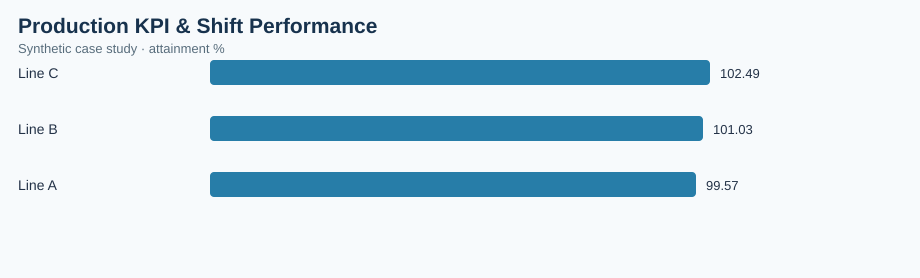

# Production KPI & Shift Performance

> **Illustrative case study — synthetic data.** All observations and financial estimates are invented for training. No claims are made about a real factory, employer, supplier, or realized savings.

## Executive brief
**Operations question:** Where does output fall below production plan and how much throughput is lost to scrap?

**Scope:** 90 synthetic records, analyzed at the dataset's documented grain. Results are descriptive and do not establish causality.

## Validated dataset summary
| KPI | Result |
|---|---:|
| observations | 90 |
| planned units | 17,460 |
| actual units | 17,640 |
| good units | 17,055 |
| attainment pct | 101.03 |
| scrap pct | 3.32 |

## Comparative analysis
| line | attainment % |
|---|---:|
| Line C | 102.49 |
| Line B | 101.03 |
| Line A | 99.57 |

**Primary observation:** Line C has the highest value on the displayed comparison (102.49 attainment %). Higher values are generally favorable; review the lowest category for intervention.

## Operational recommendation
Review lines with the lowest plan attainment and segment their output by shift before changing staffing or schedule assumptions.

## Measurement and validation
- Data source: `data.csv` in this folder, generated synthetically for this portfolio.
- Grouped metrics use weighted ratios of summed numerators and denominators where relevant; not unweighted averages of percentages.
- Chart: `summary-chart.svg`, rendered from this dataset and committed alongside this brief.
- Interpret costs as simulated exposure, not verified savings. Reassess findings with real MES, ERP, PLM, QMS or purchasing records before implementation.
- Recommended future controls: data freshness, unique record IDs, null checks, timestamp validity, and process-owner review.

## Reproduce in a free browser
Import `data.csv` into [Google Sheets](https://sheets.google.com/) and build a pivot-table dashboard.

## Portfolio presentation
**Business objective → metric definition → data checks → comparative findings → proposed countermeasure → validation plan.** This case study demonstrates analytical methodology rather than measured professional accomplishments.
