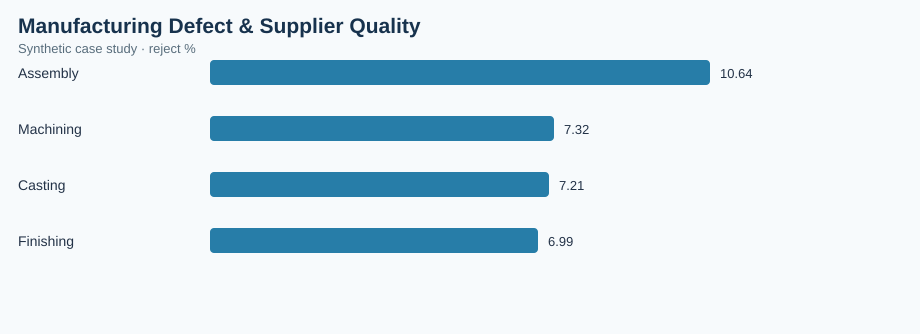

# Manufacturing Defect & Supplier Quality

> **Illustrative case study — synthetic data.** All observations and financial estimates are invented for training. No claims are made about a real factory, employer, supplier, or realized savings.

## Executive brief
**Operations question:** Which manufacturing processes have the highest reject rates, and where should quality engineering focus?

**Scope:** 120 synthetic records, analyzed at the dataset's documented grain. Results are descriptive and do not establish causality.

## Validated dataset summary
| KPI | Result |
|---|---:|
| batches | 120 |
| inspected units | 16,660 |
| rejected units | 1,342 |
| defect rate pct | 8.06 |

## Comparative analysis
| process | reject % |
|---|---:|
| Assembly | 10.64 |
| Machining | 7.32 |
| Casting | 7.21 |
| Finishing | 6.99 |

**Primary observation:** Assembly has the highest value on the displayed comparison (10.64 reject %). Higher values may signal more operational exposure; investigate denominator, volume and business context before prioritizing.

## Operational recommendation
Prioritize the process with the highest weighted reject rate, then validate defect classification and sample sizes with quality engineers.

## Measurement and validation
- Data source: `data.csv` in this folder, generated synthetically for this portfolio.
- Grouped metrics use weighted ratios of summed numerators and denominators where relevant; not unweighted averages of percentages.
- Chart: `summary-chart.svg`, rendered from this dataset and committed alongside this brief.
- Interpret costs as simulated exposure, not verified savings. Reassess findings with real MES, ERP, PLM, QMS or purchasing records before implementation.
- Recommended future controls: data freshness, unique record IDs, null checks, timestamp validity, and process-owner review.

## Reproduce in a free browser
Import `data.csv` into [SQLite Online](https://sqliteonline.com/) and run the provided SQL queries.

## Portfolio presentation
**Business objective → metric definition → data checks → comparative findings → proposed countermeasure → validation plan.** This case study demonstrates analytical methodology rather than measured professional accomplishments.
