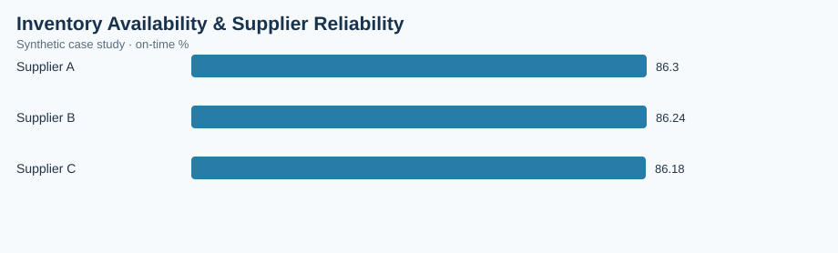

# Inventory Availability & Supplier Reliability

> **Illustrative case study — synthetic data.** All observations and financial estimates are invented for training. No claims are made about a real factory, employer, supplier, or realized savings.

## Executive brief
**Operations question:** Which components are exposed to stockout risk before replenishment, and how reliably do suppliers deliver?

**Scope:** 60 synthetic records, analyzed at the dataset's documented grain. Results are descriptive and do not establish causality.

## Validated dataset summary
| KPI | Result |
|---|---:|
| parts | 60 |
| at risk parts | 35 |
| stockout risk pct | 58.33 |
| on time delivery pct | 86.24 |

## Comparative analysis
| supplier | on-time % |
|---|---:|
| Supplier A | 86.3 |
| Supplier B | 86.24 |
| Supplier C | 86.18 |

**Primary observation:** Supplier A has the highest value on the displayed comparison (86.3 on-time %). Higher values are generally favorable; review the lowest category for intervention.

## Operational recommendation
Expedite at-risk components with days of cover below replenishment lead time and review late-delivery trends with purchasing.

## Measurement and validation
- Data source: `data.csv` in this folder, generated synthetically for this portfolio.
- Grouped metrics use weighted ratios of summed numerators and denominators where relevant; not unweighted averages of percentages.
- Chart: `summary-chart.svg`, rendered from this dataset and committed alongside this brief.
- Interpret costs as simulated exposure, not verified savings. Reassess findings with real MES, ERP, PLM, QMS or purchasing records before implementation.
- Recommended future controls: data freshness, unique record IDs, null checks, timestamp validity, and process-owner review.

## Reproduce in a free browser
Import `data.csv` into [Tableau Public](https://public.tableau.com/) and build a supplier/category dashboard.

## Portfolio presentation
**Business objective → metric definition → data checks → comparative findings → proposed countermeasure → validation plan.** This case study demonstrates analytical methodology rather than measured professional accomplishments.
