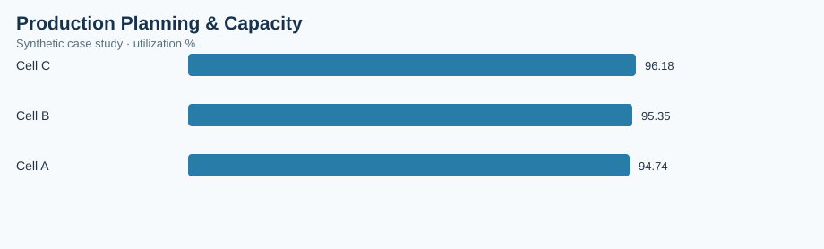

# Production Planning & Capacity

> **Illustrative case study — synthetic data.** All observations and financial estimates are invented for training. No claims are made about a real factory, employer, supplier, or realized savings.

## Executive brief
**Operations question:** Which production cells are under plan or underutilizing available capacity?

**Scope:** 84 synthetic records, analyzed at the dataset's documented grain. Results are descriptive and do not establish causality.

## Validated dataset summary
| KPI | Result |
|---|---:|
| observations | 84 |
| planned units | 42,502 |
| actual units | 40,903 |
| capacity units | 42,840 |
| plan variance units | -1,599 |
| attainment pct | 96.24 |
| utilization pct | 95.48 |

## Comparative analysis
| work cell | utilization % |
|---|---:|
| Cell C | 96.18 |
| Cell B | 95.35 |
| Cell A | 94.74 |

**Primary observation:** Cell C has the highest value on the displayed comparison (96.18 utilization %). Higher values may signal more operational exposure; investigate denominator, volume and business context before prioritizing.

## Operational recommendation
Compare cell-level utilization with plan attainment to separate demand/scheduling gaps from physical capacity constraints.

## Measurement and validation
- Data source: `data.csv` in this folder, generated synthetically for this portfolio.
- Grouped metrics use weighted ratios of summed numerators and denominators where relevant; not unweighted averages of percentages.
- Chart: `summary-chart.svg`, rendered from this dataset and committed alongside this brief.
- Interpret costs as simulated exposure, not verified savings. Reassess findings with real MES, ERP, PLM, QMS or purchasing records before implementation.
- Recommended future controls: data freshness, unique record IDs, null checks, timestamp validity, and process-owner review.

## Reproduce in a free browser
Use [Power BI Service](https://app.powerbi.com/) if your account permits browser report authoring; otherwise import the CSV into [Google Sheets](https://sheets.google.com/) and create a pivot dashboard.

## Portfolio presentation
**Business objective → metric definition → data checks → comparative findings → proposed countermeasure → validation plan.** This case study demonstrates analytical methodology rather than measured professional accomplishments.
