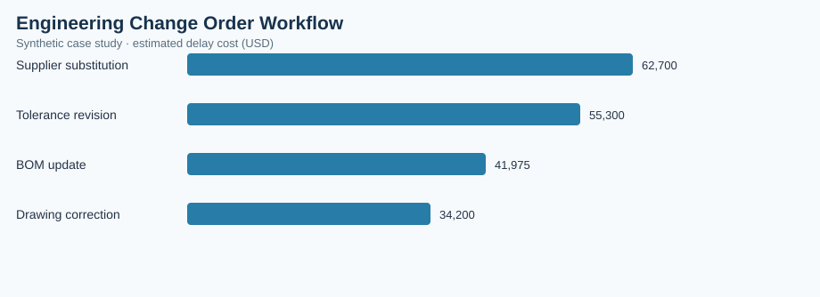

# Engineering Change Order Workflow

> **Illustrative case study — synthetic data.** All observations and financial estimates are invented for training. No claims are made about a real factory, employer, supplier, or realized savings.

## Executive brief
**Operations question:** Which engineering change categories are associated with the longest approval cycle and greatest estimated production disruption?

**Scope:** 96 synthetic records, analyzed at the dataset's documented grain. Results are descriptive and do not establish causality.

## Validated dataset summary
| KPI | Result |
|---|---:|
| changes | 96 |
| avg approval days | 12.91 |
| associated delay days | 304 |
| estimated delay cost usd | 194,175 |
| changes over 20 days | 9 |

## Comparative analysis
| change type | estimated delay cost (USD) |
|---|---:|
| Supplier substitution | 62,700 |
| Tolerance revision | 55,300 |
| BOM update | 41,975 |
| Drawing correction | 34,200 |

**Primary observation:** Supplier substitution has the highest value on the displayed comparison (62,700 estimated delay cost (USD)). Higher values may signal more operational exposure; investigate denominator, volume and business context before prioritizing.

## Operational recommendation
Review change categories with highest associated delay cost; establish engineering/operations approval SLAs and track revision release-to-production lag.

## Measurement and validation
- Data source: `data.csv` in this folder, generated synthetically for this portfolio.
- Grouped metrics use weighted ratios of summed numerators and denominators where relevant; not unweighted averages of percentages.
- Chart: `summary-chart.svg`, rendered from this dataset and committed alongside this brief.
- Interpret costs as simulated exposure, not verified savings. Reassess findings with real MES, ERP, PLM, QMS or purchasing records before implementation.
- Recommended future controls: data freshness, unique record IDs, null checks, timestamp validity, and process-owner review.

## Reproduce in a free browser
Upload the included `analysis.ipynb` to [Google Colab](https://colab.research.google.com/) and run all cells.

## Portfolio presentation
**Business objective → metric definition → data checks → comparative findings → proposed countermeasure → validation plan.** This case study demonstrates analytical methodology rather than measured professional accomplishments.
